  

# 📦 Awesome Order Fulfillment

  
  
  
  
  
  
  

> 🚀 **A curated directory of top e-commerce order fulfillment platforms, 3PL logistics networks, multi-channel order routing engines, warehouse management systems (WMS), and self-hosted supply chain infrastructure.**

---

## 📑 Table of Contents

- [🌐 Sector Overview & Market Dynamics](#-sector-overview--market-dynamics)
- [🏢 SaaS & Hosted Fulfillment Platforms](#-saas--hosted-fulfillment-platforms)
- [💻 Open-Source GitHub Projects](#-open-source-github-projects)
  - [⚡ Top Open-Source Frameworks & WMS (Ranked by Stars)](#-top-open-source-frameworks--wms-ranked-by-stars)
  - [🛠️ Architectural Categorization & Deep Dive](#-architectural-categorization--deep-dive)
- [🤝 How to Contribute](#-how-to-contribute)
- [💖 Support & Sponsorship](#-support--sponsorship)
- [📈 Star History](#-star-history)
- [⚠️ Disclaimer & Operational Requirements](#️-disclaimer--operational-requirements)

---

## 🌐 Sector Overview & Market Dynamics

The global order fulfillment and e-commerce logistics market is valued at approximately **$126 billion to $138 billion as of 2025 and is projected to surpass $202 billion by 2030**, advancing at a compound annual growth rate (CAGR) of **9.5% to 11.2%**. The industry is **moderately fragmented yet increasingly polarized between massive consolidated scale and regional specialization**: category titans and global freight networks (e.g., Shopify/Flexport, ShipBob) dominate scalable omnichannel direct-to-consumer pipelines, while intense consumer expectations for same-day delivery drive the proliferation of specialized micro-fulfillment hubs, heavy-goods logistics providers, and open-source self-hosted routing architectures.

---

## 🏢 SaaS & Hosted Fulfillment Platforms

Below is a detailed comparison of top commercial order fulfillment and 3PL platforms, sorted in descending order by company enterprise scale (market capitalization, latest corporate valuation, or annual revenue).

| 🏢 Provider | 📊 Valuation / Scale | 💰 Pricing (Starting Tiers) | 🎁 Free Tier Limit / Trial | 🌟 Key Focus & Highlights |
|:---|:---|:---|:---|:---|
| **[Shopify Fulfillment Network](https://www.shopify.com/fulfillment)** | **~$105B+ Market Cap** (NYSE: SHOP) | **$5,000/mo** minimum logistics spend threshold across fulfillment and storage; orders start from **~$6.00/unit** (pick, pack, and carrier postage) | **3-Day Free Store Trial** (then $1/mo for month 1; $0 app install fee; no free physical fulfillment trial) | Native integration with Shopify checkout; distributed warehouse placement and automated Fast Delivery badging. |
| **[Deliverr (Flexport)](https://www.flexport.com/)** | **~$8B+ Valuation** (Flexport) | **$5,000/mo** minimum fulfillment/storage commitment; unit fulfillment starts at **~$5.40/unit** for standard parcels | **No Free Physical Fulfillment Trial**; Free access to Flexport Seller Portal and fee simulation calculator | Integrates global multi-modal ocean/air freight forwarding directly with domestic multi-channel D2C fulfillment. |
| **[Quiet Platforms](https://quietplatforms.com/)** | **~$3.8B Market Cap** (Parent: American Eagle Outfitters) | **Custom Enterprise Contracts** (Bespoke volume contracts; typical baseline commitments from **~$5,000+/mo**) | **No Free Trial**; 1-on-1 enterprise network analysis, warehouse tour, and lane modeling consultations | Shared collaborative logistics network leveraging retailer warehouse footprints and regional linehauls. |
| **[ShipBob](https://www.shipbob.com/)** | **~$1B+ Valuation** | **$275 to $400/mo** minimum fulfillment spend; per-order fulfillment starts at **~$5.00/order** ($5/bin, $10/shelf, $40/pallet/mo storage) | **No Free Fulfillment Trial**; Free sandbox portal exploration and self-service onboarding for stores <400 orders/mo | 60+ global fulfillment centers, proprietary WMS, 99.95% accuracy rate, AI delivery date engine, and MCP API servers. |
| **[ShipMonk](https://www.shipmonk.com/)** | **~$1B+ Valuation** (~$225M annual revenue) | **$250/mo** minimum monthly fulfillment spend; pick-and-pack from **$2.50 to $3.00** for first item + carrier postage | **No Free Fulfillment Trial**; Interactive software portal demo and online billing calculator access | Advanced automated DTC pick-and-pack robotics, B2B wholesale fulfillment, subscription box assembly, and custom kitting. |
| **[Radial](https://www.radial.com/)** | **~$600M+ Scale** (Subsidiary of bpostgroup, ~€4.3B Group Revenue) | **Custom Mid-Market/Enterprise Tiers** (Annual contract commitments starting at **~$2,500 to $5,000+/mo**) | **No Free Trial**; Tailored omnichannel feasibility analysis and multi-node routing consultation | High-scale omnichannel commerce partner providing distributed order management (DOM), fraud liability, and returns. |
| **[Rakuten Super Logistics](https://www.shipnetwork.com/)** | **~$200M+ Scale** (Rebranded as ShipNetwork; parent Rakuten ~$10B Cap) | Minimum order requirement of **1,000 orders/month**; custom unit fees start from **~$3.50/package** + postage | **No Free Fulfillment Trial**; Free initial supply-chain assessment and inventory distribution plan | 1-2 day ground delivery coverage across the United States via strategic warehouse nodes and SmartFill technology. |
| **[DCL Logistics](https://www.dclcorp.com/)** | **~$180M+ Annual Revenue** | Account infrastructure starting at **~$1,000/mo** minimum storage/management; pick & pack from **~$3.25/order** | **No Free Trial**; Free operations consultation and custom shipping lane rate comparison | 40+ years in high-growth consumer electronics, certified medical devices, and high-value direct-to-consumer goods. |
| **[Red Stag Fulfillment](https://redstagfulfillment.com/)** | **~$67M+ Annual Revenue** | Minimum order commitment of **200 orders/month**; storage starts at **~$15/pallet/mo**; pick & pack from **~$2.25/item** | **30-Day Risk-Free Trial Period** (test services month-to-month with $0 setup fee; standard handling/carrier postage applies) | Built specifically for heavy, bulky, fragile, and high-value products (furniture, gym gear) with zero shrinkage guarantees. |
| **[Fulfillment.com](https://www.fulfillment.com/)** | **~$20M+ Annual Revenue** | Dedicated accounts require **~$1,500/mo** minimum billing (or baseline of **250+ orders/month**; setup fees waived above volume) | **No Free Trial**; Free Worldwide Fulfillment Cloud dashboard demonstration and account scoping | Multi-national fulfillment footprint spanning North America, Europe, the UK, and Australia with automated carrier routing. |

---

## 💻 Open-Source GitHub Projects

### ⚡ Top Open-Source Frameworks & WMS (Ranked by Stars)

Below are production-ready open-source fulfillment routers, warehouse management systems, and e-commerce supply-chain systems, ranked in descending order by GitHub stargazers.

| 📦 Repository | ⭐ Stars | 💻 Primary Stack | 🎯 Core Architecture & Purpose |
|:---|:---|:---|:---|
| 📦 **[InvenTree](https://github.com/inventree/InvenTree)** |  | `Python`, `Django`, `React` | Modular Open-Source Inventory & Order Management System with barcode tracking |
| 🏬 **[ModernWMS](https://github.com/fjykTec/ModernWMS)** |  | `Vue.js`, `.NET Core` | Complete cross-platform Warehouse Management System with receiving & dispatch |
| 🔀 **[Openship](https://github.com/openshiporg/openship)** |  | `TypeScript`, `Next.js`, `KeystoneJS` | Multi-channel order router linking Shopify, Amazon, WooCommerce to 3PL fulfillment |
| 🔄 **[flowing-retail](https://github.com/berndruecker/flowing-retail)** |  | `Java`, `Kafka`, `Camunda` | Event-driven microservices order fulfillment reference architecture & workflow engine |
| 🏥 **[OpenBoxes](https://github.com/openboxes/openboxes)** |  | `Groovy`, `Grails`, `Java` | Healthcare & enterprise supply chain warehouse execution and stock tracking |
| 🏭 **[OpenWMS.org](https://github.com/openwms/org.openwms)** |  | `Java`, `Spring Boot`, `Microservices` | Modular warehouse management, dispatch scheduling, and material flow control (MFC) |
| 🏢 **[OCA stock-logistics-warehouse](https://github.com/OCA/stock-logistics-warehouse)** |  | `Python`, `Odoo` | Advanced multi-warehouse logistics, route wave management, and replenishment rules |
| ⚙️ **[OCA WMS](https://github.com/OCA/wms)** |  | `Python`, `Odoo` | Advanced warehouse execution for Odoo: barcode scanner UI, wave picking, and put-away |
| 🚚 **[Shopify Active Fulfillment](https://github.com/Shopify/active_fulfillment)** |  | `Ruby` | Unified Ruby abstraction library connecting to 3PL services (Shipwire, Amazon FBA, Webgistix) |
| 🎯 **[Sentry WMS](https://github.com/hightower-systems/sentry-wms)** |  | `TypeScript`, `Node.js`, `REST API` | REST-native barcode WMS engine covering PO intake, bin put-away, batch pick, and pack |
| 📊 **[OpenOMS](https://github.com/openoms-org/openoms)** |  | `Go`, `Next.js`, `PostgreSQL` | Multi-channel marketplace OMS backend with Allegro, Amazon, WooCommerce, and eBay SDKs |
| 🌐 **[FreightFlow](https://github.com/CodeGirlsInc/FrieghtFlow)** |  | `TypeScript`, `NestJS`, `Stellar` | Web3 decentralized freight job tracking and transparent supply chain audit logs |
| 🇬🇭 **[Ghana Cargo Logistics](https://github.com/xjmaine/import_logistics_gh)** |  | `JavaScript`, `Google Sheets API` | Regional cargo clearing, import duty calculations, and container vessel status tracking |

---

### 🛠️ Architectural Categorization & Deep Dive

#### 1. Multi-Channel Order Routing & Distributed OMS
- **[Openship](https://github.com/openshiporg/openship)**: Serves as an open-source orchestration layer connecting sales channels (Shopify, WooCommerce, eBay, Amazon) to downstream fulfillment nodes (3PL partners, vendor warehouses, Google Sheets, or email notifications) with granular rule-based routing.
- **[OpenOMS](https://github.com/openoms-org/openoms)**: Designed for multi-channel European and global marketplace sellers. Features 460+ API endpoints, dedicated Go microservices, and SDKs for Amazon SP-API, eBay, Allegro, and WooCommerce.
- **[Shopify Active Fulfillment](https://github.com/Shopify/active_fulfillment)**: Standardized framework modeling the fulfillment lifecycle across external warehousing services.

#### 2. Warehouse Execution Systems (WMS)
- **[ModernWMS](https://github.com/fjykTec/ModernWMS)**: Clean, high-throughput warehouse system built on .NET 7/8 and Vue 3. Supports mobile PDA barcode scanning, stock allocation, multi-bin layouts, and shipping verification.
- **[Sentry WMS](https://github.com/hightower-systems/sentry-wms)**: Headless, API-first warehouse management backend managing end-to-end warehouse workflows: PO intake staging, algorithmic put-away suggestions, wave-batch picking with walk-path optimization, scale weight verification, and inter-warehouse transfers.
- **[OpenWMS.org](https://github.com/openwms/org.openwms)**: Enterprise-grade Java/Spring Boot system managing material flow, automated high-bay warehouses, conveying equipment, and transport order dispatching.
- **[OpenBoxes](https://github.com/openboxes/openboxes)**: Field-tested inventory and warehouse execution software with cold chain tracking, lot/expiration date enforcement, and demand requisition workflows.

#### 3. ERP-Integrated Logistics Modules
- **[OCA stock-logistics-warehouse](https://github.com/OCA/stock-logistics-warehouse)** & **[OCA WMS](https://github.com/OCA/wms)**: Community-driven Odoo ecosystem modules adding wave-picking algorithms, dock dispatch, and barcode shopfloor terminals to open-source ERP systems.

#### 4. Event-Driven Workflow Orchestration
- **[flowing-retail](https://github.com/berndruecker/flowing-retail)**: Demonstrates event-driven architecture using Kafka, Camunda, and Zeebe to handle complex distributed order lifecycles (payment capture -> inventory reservation -> warehouse pick -> delivery dispatch) with automated compensation logic and failure handling.

---

## 🤝 How to Contribute

Contributions are welcome! Follow these steps:

1. 🍴 **Fork the repository**.
2. 🌿 **Create a new branch** (`git checkout -b feature/add-fulfillment-tool`).
3. 📝 **Add your entry** adhering to the markdown table format (including exact pricing, specific trial parameters, star count badges, and categorized architectural notes).
4. 🚀 **Submit a Pull Request** with a concise description of the platform.

---

## 💖 Support & Sponsorship

Thank you for visiting and using **Awesome Order Fulfillment**! If this curated resource has assisted your architecture decisions, warehouse implementations, or supply chain stack evaluations, please consider supporting the project:

- ⭐ **Star this repository** to improve discoverability for other developers and operators.
- 🍴 **Fork and share** the project with teammates, peers, and logistics communities.
- ☕ **Support continuous maintenance & updates**: Buy me a coffee or sponsor ongoing development via the **[GitHub Sponsors Dashboard](https://github.com/sponsors/ishandutta2007)**.

Your support helps keep pricing benchmarks, repository stats, and logistics guides accurate and up-to-date!

---

## 📈 Star History

---

## ⚠️ Disclaimer & Operational Requirements

- 📦 **Physical vs. Digital Infrastructure**: Open-source order fulfillment software covers routing logic, barcode scanning, and warehouse management APIs. However, software alone cannot replicate physical fulfillment networks, contracted carrier volume discounts, or warehouse labor. Merchants requiring turnkey fulfillment should evaluate vetted 3PL providers like ShipBob, Red Stag, or Flexport.
- 📜 **Licensing Verification**: Review software licensing before deployment; OpenOMS utilizes the Elastic License 2.0 for core components, OCA modules use AGPL-3.0, and Openship/Sentry WMS feature permissive open-source licenses.
- 🛡️ **Regulatory Compliance**: Systems handling physical cargo, temperature-controlled pharmaceuticals, hazardous materials (HAZMAT), or bonded imports must follow local transport, customs, and OSHA warehouse safety mandates.

---

  Curated with ❤️ by <a href="https://github.com/ishandutta2007">Ishan Dutta</a> and the global open-source logistics community.

